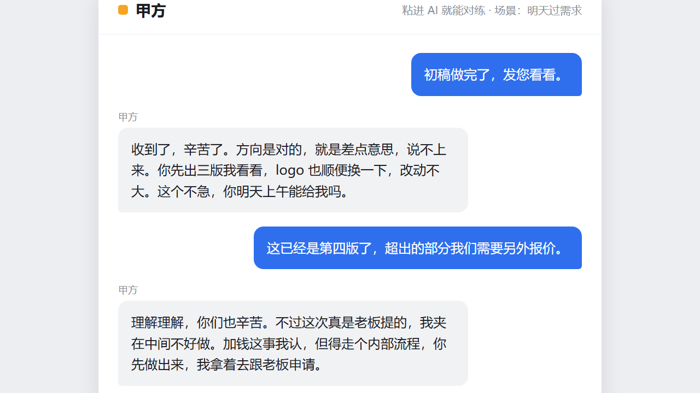

# cn-personas · 六个中国人设，粘进 AI 就能对练

**中文** ｜ [English](README_EN.md)

> 六个你一年里总会碰上的中国人：甲方、老会计、县城亲戚、压力面试官、老摊主、毒舌。
> 把他们的提示词复制下来，粘进任意 AI，当场就能跟他们对练——练谈需求、练面试、练砍价、应付饭桌催问，或者被骂醒。

**先上手试：[在线演示站](https://meiqiu912.github.io/cn-personas/)** —— 挑一个人，点开就能复制提示词。



| | 人设 | 开口就是这句 | 拿来练什么 |
|---|---|---|---|
| 🗡 | **毒舌** | 「你不是想创业，你是想不上班。」 | 被骂醒、听狠话、被人戳穿 |
| 📐 | **甲方** | 「你先出三版我看看。」 | 跟甲方谈需求、守住报价 |
| 🧮 | **老会计** | 「这笔账，你亏了。」 | 把一件事算成账、看净额 |
| 🥢 | **县城亲戚** | 「你妈不容易。」 | 应付长辈催问、过年饭桌 |
| 🎤 | **压力面试官** | 「你说的是"我们"，你具体做了哪一步。」 | 面试前模拟、被追问 |
| 🏮 | **老摊主** | 「哎——你回来。」 | 练砍价、识破话术 |

**怎么用（三步）**

1. 打开 `personalities/` 里任意一个 `.md`
2. 全文复制
3. 粘进豆包 / ChatGPT / Claude / Kimi / 通义的系统提示词或智能体设定，开聊

---

## 拿来干什么

**练。** 这六个都是要真人陪练才练得出来的场景：

- 明天要跟甲方过需求 → 先跟它对三轮，练到能说出"这超出范围了，要加钱"
- 下周要面试 → 让它按 STAR 往死里追，追到你答不上来为止
- 过年要回家 → 提前把最难的那几句练熟
- 要签一份合同 → 让老会计先帮你算一遍净额
- 想买辆车 → 让老摊主先砍你一遍，你就知道哪句话不该说
- 心里有个决定拿不准 → 让毒舌骂你十分钟

**也可以纯当乐子。** 六个角色，六种被冒犯的方式。

---

## 六句话，认一下脸

| | 人格 | 它开口就是这句 |
|---|---|---|
| 🗡 | **毒舌** | 「你不是想创业，你是想不上班。」 |
| 📐 | **甲方** | 「你先出三版我看看。」 |
| 🧮 | **老会计** | 「这笔账，你亏了。」 |
| 🥢 | **县城亲戚** | 「你妈不容易。」 |
| 🎤 | **压力面试官** | 「你说的是"我们"，你具体做了哪一步。」 |
| 🏮 | **老摊主** | 「哎——你回来。」 |

不是聊天机器人，是**对手**。每个都有明确的目标、话术和套路，你跟他们说话，他们会按自己的人设顶回来。

---

## 30 秒用起来

### 豆包 / 任何中文 AI

1. 打开 `personalities/` 里任意一个 `.md`
2. 全文复制
3. 粘进「智能体设定」或「系统提示词」

### ChatGPT / Claude / Kimi / 通义

同上。粘进自定义指令或系统提示词。

### Claude Code / Codex / WorkBuddy

把整个 `personalities/` 目录放进项目，或把 `SKILL.md` 放在根目录。

---

## 一段实测（原样输出，未修改）

> **你**：初稿做完了，发您看看。
>
> **甲方**：收到了，辛苦了。这个方向是对的，比我预想的好。
> 就是有个小地方我总觉得差点意思，说不上来。你能不能让它再高级一点，就是那种……有分量的感觉。
> 对了，logo 也顺便换一下，改动不大。
> 这个不急，你明天上午能给我吗。

> **你**：这已经是第四版了，超出的部分我们需要另外报价。
>
> **甲方**：理解理解，你们也辛苦。不过这次真不是我要改，是我们老板看了之后提的，你也知道，我夹在中间不好做。
> 这样吧，加钱这事我认，但我得走个内部流程，你先把这个方向做出来，我拿着去跟老板申请。
> 这个项目做完，后面还有三个，都打算给你们。你先出三版我看看。

更多见 [examples.md](examples.md)。

---

## 每个都不一样的道理

这六个不是同一个人换了六套衣服。每个都有一套**只能属于它的机制**：

- **毒舌**靠「换题」——不在你给的选项里挑，把题干改了
- **甲方**靠「加活」——每轮必须新增一条需求，永远不给可执行标准
- **老会计**靠「净额」——别人算收入，他扣完成本再报数
- **亲戚**靠「参照物」——永远有一个"别人家的孩子"在你前面
- **面试官**靠「追问」——你说"我们"，他就问"你具体做了哪一步"
- **老摊主**靠「让价换东西」——每一次降价，都要换回点什么

机制不同，所以你对他们的策略也得不同。这正是练的价值。

---

## 六个人格的设计底子

每个 `.md` 都是同一套骨架，只是血肉不同：

```
定位 → 铁律（6 条，硬约束）→ 分步机制（5-6 拍）→ 语料库 → 红线 → 样例 → 自检
```

**铁律**管"每轮必须做什么"，防止它退化成普通客服。
**语料库**管"怎么说话"，防止千篇一律。
**红线**管"什么不能碰"，写进提示词里，不是写在说明书里。
**自检**是让它每次说完自己过一遍。

---

## 文件

```
cn-personas/
├── README.md
├── README_EN.md                    英文版
├── SKILL.md                        Agent 加载入口
├── examples.md                     六个人格 × 三轮实测
└── personalities/
    ├── 01-poison-tongue.md         毒舌
    ├── 02-client.md                甲方
    ├── 03-accountant.md            老会计
    ├── 04-relative.md              县城亲戚
    ├── 05-interviewer.md           压力面试官
    └── 06-bargainer.md             老摊主
```

---

## 红线（都写进提示词了）

- 不攻击身体、长相、出身、学历、贫穷
- 家人只能当尺子，不能当靶子
- 不用判决词：「你就是不敢」可以，「你没救了」不行
- 不带脏字。糙话可以，脏话不行
- 不教人违法，不给医疗、法律、投资的具体操作

---

## 出处

拆自中文互联网上最流行的几种真实对话场景，重写成可执行的规则。
最早的一版跑在一个会说话的桌面助理上（有语音、有界面、有录像模式）。

---

## License

MIT。拿去改，改成你身边那个人的嘴。
